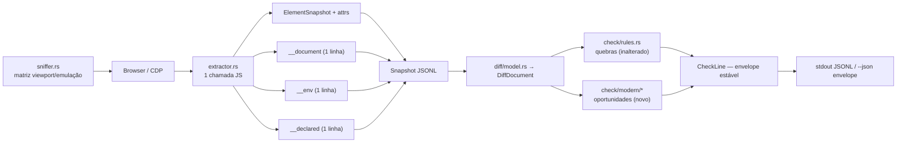

# 2. Arquitetura alvo — onde a mudança vive

## 2.1 Princípios de encaixe

1. **Quebra só com ganho analítico.** O v0.6 escreve snapshot v2 com contexto
   ligado por default e `evidence` estruturado; a leitura de v1 é migrada em
   memória. Detalhes e gate em [`08-contrato-v2.md`](08-contrato-v2.md).
2. **Offline continua offline.** `sniff check` nunca abre browser. Toda
   oportunidade é computada a partir do JSONL + facetas capturadas.
3. **Facet global antes de facet por nó.** Uma linha por captura custa
   insignificante; um campo em cada nó multiplica por centenas.
4. **Contexto rico por default, escape hatch explícito.** `__document`,
   `__env` e o preset curado de `attrs` vêm ligados; `--minimal` restaura o
   perfil enxuto. `declared` e matriz continuam opt-in por custo.
5. **Ausência ≠ falha.** Se a facet exigida por um check não está no snapshot,
   o check **não emite linha** (padrão já usado em `rules.rs`: `RuleStatus` só
   tem `pass`/`warn`/`fail`). Nunca inventar `unknown` como novo status sem
   necessidade — isso mudaria o envelope.
6. **Evidência estruturada.** `evidence` é um objeto com `text`, `metric`,
   `observed`, `threshold`, `comparator` e `source`; o agente filtra números
   sem regex e sabe qual facet sustenta o check.

## 2.2 Fluxo de dados



A matriz de estados (F3) é a única mudança que multiplica passadas CDP. Ela
deve produzir **um arquivo JSONL com N blocos**, cada um com
`__meta.matrix{index,total,viewport,emulation}`, e ser consumida por
`sniff check --modern --responsive`.

## 2.3 Mudanças por crate

### `sniff-core`

| Arquivo | Mudança |
|---|---|
| `src/config.rs` | Novos campos em `SniffConfig`: `document_facet`, `env_facet`, `attr_preset` (default **ligados**), `declared_facet`, `emulate`, `matrix_viewports` (default desligados/vazios), `minimal: bool`. |
| `src/types.rs` | Novos structs globais `DocumentFacet`, `EnvFacet`, `DeclaredRule`, `MatrixTag`. `ElementSnapshot` **inalterado**. |
| `src/properties.rs` | Ampliar o catálogo com as propriedades que os findings provaram necessárias: `appearance`, `accent-color`, `field-sizing`, `interpolate-size`, `scroll-initial-target`, `scroll-target-group`, `view-transition-scope`, `view-transition-group`, `view-transition-class`, `content-visibility`, `contain-intrinsic-size`, `container-type`, `scrollbar-width`, `scrollbar-gutter`, `color-scheme`, `forced-color-adjust`, `overscroll-behavior`, `overflow-anchor`, `view-transition-name`, `anchor-name`, `position-anchor`, `offset-path`. |
| `src/modern.rs` (novo) | Tipos compartilhados: `GuideRef(&'static str)`, `Severity`, `ObservabilityClass`. Sem lógica de checagem. |

### `sniff-cdp`

| Arquivo | Mudança |
|---|---|
| `src/session.rs` | Generalizar `set_emulated_media` de `prefers-reduced-motion` fixo para `features: &[(String, String)]`. Manter o wrapper atual usado pela estabilização para não duplicar chamada. |

### `sniff-engine`

| Arquivo | Mudança |
|---|---|
| `src/extractor.rs` | Estender o JS único para devolver `document`/`env` uma vez; `document.styleSheets` com `try/catch` por folha (`SecurityError` → `blocked: true`). |
| `src/extractor.rs` (walker) | Recursão em `el.shadowRoot` (modo `open`) no mesmo `Runtime.evaluate` — destrava 5 guias de Web Components sem round-trip; `mode:'closed'` permanece N. |
| `src/document.rs` (novo) | Parse puro `Value → DocumentFacet`; testável sem browser. |
| `src/env.rs` (novo) | Parse puro de `matchMedia`; normalizar valores para strings fechadas. |
| `src/declared.rs` (novo) | Parse de regras CSSOM casadas, com `origin` e `href`; dedupe por seletor. |
| `src/sniffer.rs` | Orquestrar matriz: aplicar emulação + viewport, capturar, anexar `MatrixTag`; ordem dos estados = ordem da config. |
| `src/output.rs` | Emitir `__document`/`__env`/`__declared` como linhas globais e `matrix` dentro de `__meta`. |
| `src/output.rs` (extra) | Emitir `effective_background` calculado (hoje resolvido, não serializado) para `accent-color-contrast`. |

### `sniff-css-diff`

| Arquivo | Mudança |
|---|---|
| `src/model.rs` | `DiffDocument` ganha `document: Option<DocumentFacet>`, `env: Option<EnvFacet>`, `declared: Option<Vec<DeclaredRule>>`, `matrix: Vec<MatrixTag>`. Parsers tolerantas a ausência. Nenhum campo novo em `DiffNode` — globals não são por nó. |

### `sniff-css-check`

| Arquivo | Mudança |
|---|---|
| `src/lib.rs` | `pub mod modern;` + re-export de `run_modern_checks`. |
| `src/modern/mod.rs` | Registro de checks (id → guia → facet exigida → family) e dispatcher. |
| `src/modern/structure.rs` | h1/headings/landmarks/ARIA redundante/dimensões de imagem/lang/title. |
| `src/modern/platform.rs` | Modal vs `<dialog>`, popover, `<details>`, forms, selects, switches, text scale, dark mode. |
| `src/modern/responsive.rs` | Diferenças entre estados da matriz (overflow, saltos de layout, preferências ignoradas). |
| `src/modern/performance.rs` | Proxy de custo de pintura/animamento e peso de DOM. |
| `src/rules.rs` | Migrar a construção de `evidence` para `Evidence::new(...)` (texto + campos tipados); a lógica das regras permanece. `src/modern/*` usa o mesmo tipo. |

`CheckLine` no contrato v2 (ver `08-contrato-v2.md` §B2/B3):

```rust
pub struct CheckLine {
    pub check: String,
    pub selector: String,
    #[serde(skip_serializing_if = "Option::is_none")]
    pub tag: Option<String>,
    pub status: RuleStatus,
    pub class: CheckClass,             // "bug" | "opportunity"
    pub evidence: Evidence,            // { text, metric?, observed?, threshold?, comparator?, source? }
    #[serde(skip_serializing_if = "Option::is_none")]
    pub guide: Option<&'static str>,   // id do guia, só em oportunidades
    #[serde(skip_serializing_if = "Option::is_none")]
    pub severity: Option<Severity>,    // warn | fail
    #[serde(skip_serializing_if = "Option::is_none")]
    pub metrics: Option<Value>,        // fatos auxiliares tipados
}
```

`keepWhen` **não** vai no JSON: é documentação e teste, não ruído de token.
`guide` permite ao agente abrir a recomendação exata do corpus.

### `sniff-css` (binário)

| Arquivo | Mudança |
|---|---|
| `src/cli/capture.rs` | `--minimal` (desliga o contexto default); `--no-document`/`--no-env`; `--declared`, `--emulate K=V`, `--viewport-matrix WxH,WxH`, `--attrs-preset`; `--declared-limit`. |
| `src/cli/check.rs` | `--rules` (somente quebras), `--modern` (somente oportunidades), `--no-modern`, `--guide ID`, `--ignore CHECK`, `--profile default\|strict`, `--responsive`. |
| `src/commands/{capture,check}.rs` | Ligação com `SniffConfig`, `run_modern_checks` e `Evidence`. |
| `src/output.rs` / envelope | `--json.data` ganha `checks` com `class`, `modern` e `opportunities_by_class` no `__check_summary`. Envelope externo inalterado. |

### `sniff-css-mcp`

Nenhuma nova ferramenta: os mesmos parâmetros viram campos opcionais nas
chamadas existentes de `capture`/`check`. Resposta aditiva.

## 2.4 Versionamento e migração (contrato v2)

| Situação | Comportamento |
|---|---|
| Snapshot v1 + binário v0.6 | Loader sobe para v2 em memória (`__meta.schema=2`, facets vazias); checks dependentes de contexto silenciam. Sem erro. |
| Snapshot v2 + binário antigo | Linhas `__*` desconhecidas são ignoradas pelo parser antigo; verificar no teste de migração. |
| `sniff check` sem flags | Roda `uniformity` + `rules` + `modern` (nova default). |
| `sniff check --rules` | Somente quebras — **mudança de significado** documentada em `08-contrato-v2.md` §B2. |
| `sniff prime` | Atualizado no bump v0.6 para explicar `class`, `evidence`, `__document`/`__env` e as novas flags. |
| `--minimal` | Perfil enxuto: sem `__document`/`__env`/`attrs` default; útil para token budget extremo. |
| `--compact` | Facetas globais não são deduplicadas; uma linha cada, fora do hoist de `style_defaults`. |

**Nota:** a compatibilidade de **leitura** é mantida; a quebra é de
**escrita** e de significado de `--rules`. Nenhuma quebra é cosmética.

## 2.5 Orçamento de performance

- Custo por nó: o preset `attrs` (≈20 nomes curtos) entra no default e precisa
  de medição com `--depth 10`; `--minimal` desliga. `__document`/`__env`/
  `__declared` são globais (zero por nó).
- `declared` é limitado a seletores efetivamente capturados e a no máximo
  `--declared-limit` regras (default 200), com ordem estável (índice da folha
  de estilo, depois ordem da regra).
- Matriz: custo linear em N estados. Default N=1. Avisar no `--json` quando
  N>1 (campo `warnings` do envelope).
- `check` roda sobre JSONL já em memória: `modern/*` deve fazer no máximo uma
  passagem adicional sobre a floresta, reaproveitando o `flatten` que
  `rules.rs` já constrói para oclusão.

## 2.6 Determinismo

- Toda coleção nova usa `BTreeMap`/`BTreeSet` (política A1 de `phase-3.md`).
- `__env` normaliza `matchMedia` para um conjunto fechado de chaves em ordem
  alfabética; nunca serializa o objeto cru do browser.
- `__declared` ordena por `(href, rule_index, selector)`.
- `__meta.matrix` ordena por `index`.
- Nenhuma leitura de `env`/relógio fora dos pontos centralizados
  (`sniff_core::env`, `snapshot::utc_now`) — lints `disallowed_methods` já
  protegem isso.

## 2.7 Sequência de implementação sugerida

A ordem segue dependências técnicas, não valor percebido:

```
config + types + parsers (F0)
        ├── attrs preset ───────────► structure checks (F1)
        ├── __document + __env ─────► platform checks (F2)
        ├── matrix CDP ─────────────► responsive checks (F3)
        └── declared CSSOM ─────────► disambiguation dos anteriores
                                     performance checks (F4) usam __actions + attrs
```

`declared` vem depois porque ele **refina** checks que já funcionam com
heurística conservadora; começar por ele atrasaria o primeiro valor entregue.
