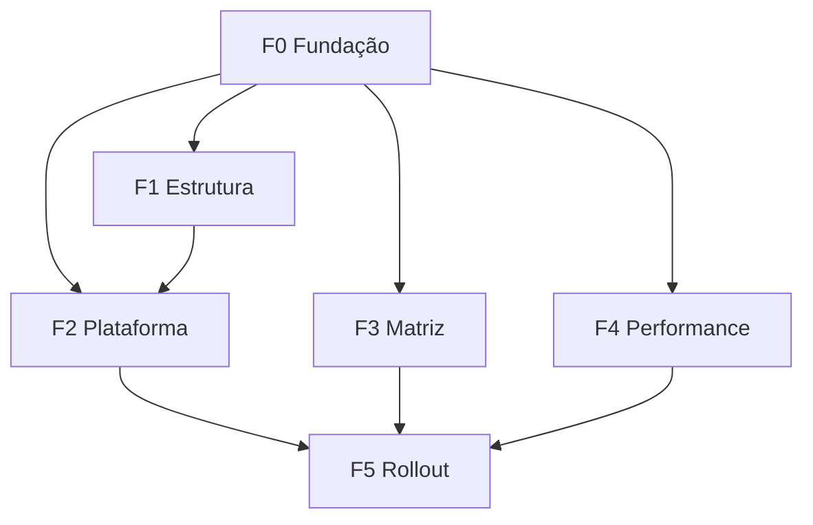

# 6. Roadmap — fases, dependências e aceite

Estimativas em **dias de desenvolvedor** (planejamento, não medição). Cada fase
termina com gate verde; não há "fase adiantada" que pule validação.

## 6.1 Visão das fases

| Fase | Nome | Esforço | Valor | Risco principal |
|---|---|---:|---|---|
| F0 | Fundação v2 (facets + envelope + migração) | 7–10 d | Nenhum direto | Migração v1→v2 e custo do preset de `attrs` |
| F1 | Estrutura e semântica automatizada | 3–5 d | Alto, custo baixíssimo | Falso positivo em heading/landmark |
| F2 | Adoção da plataforma | 6–10 d | Altíssimo | `keepWhen` mal calibrado |
| F3 | Matriz responsiva e preferências | 5–8 d | Alto | Custo N× e emulação conflitante |
| F4 | Proxies de performance | 3–5 d | Médio | Confundir proxy com medição real |
| F5 | Release, MCP e documentação | 3–4 d | Adoção | Documentação duplicada |

**Total estimado: 27–42 dias de desenvolvedor.**

F1 e F2 não dependem de F3: a primeira entrega de valor não precisa de matriz
nem de CSSOM.

---

## F0 — Fundação de facets e envelope

**Escopo**

  `matrix_viewports` (default vazio) e `minimal: bool`. `document_facet`,
  `env_facet` e `attr_preset` entram **ligados** no v0.6.
- `DocumentFacet`, `EnvFacet`, `DeclaredRule`, `MatrixTag` em `sniff-core`.
- Presets de `attrs`; extensão do JS único do `extractor.rs`.
- `DiffDocument` com os novos globais; parsers tolerantes.
- `Evidence::{new,text}` + `CheckLine.class/guide/severity/metrics` (contrato v2).
- Flags de CLI correspondentes (documentação de flag em `usage.md` e
  `cli-surface.md`, não neste diretório).
- `set_emulated_media` generalizado em `sniff-cdp`.

**Aceite**

- [ ] `sniff capture URL -s body` (sem flags) emite `__meta.schema=2`,
      `__document`, `__env` e `attrs` no formato de `03-facets.md`.
- [ ] `sniff check --rules` (somente quebras) produz saída equivalente à
      anterior **exceto** pelo `evidence` tipado — migração documentada.
- [ ] Snapshot v1 + binário v0.6: migração em memória, checks sem contexto
      silenciam, `sniff diff v1 v2` funciona.
- [ ] Snapshot v2 + binário antigo: linhas `__*` desconhecidas ignoradas.
- [ ] `--minimal` reproduz o perfil enxuto e o overhead medido < 10% em
      `compact`.
- [ ] Todos os parsers de facet têm teste puro + teste Chrome-gated.
- [ ] `cargo fmt`, `clippy -D warnings`, `test --workspace`, `deny check` verdes.

---

## F1 — Estrutura e semântica automatizada

**Motivo:** transforma o checklist manual de
[`docs/accessibility.md`](../accessibility.md) §"Checklist de julgamento" em
evidência automática. É o menor custo e o maior ganho imediato.

**Checks iniciais**

Checks da [Família A](04-catalogo-de-checks.md#43-família-a--estrutura-semântica-e-metadata-f1):
`document-metadata-basics`, `form-semantics-basics`,
`breadcrumb-current-page-missing`, `generated-content-alt`,
`live-region-announcer`, `card-interactive-nested-in-link`,
`site-nav-using-menu-roles`, `scroll-region-without-name`.
Os ids e `keepWhen` finais vêm consolidados no catálogo — a lista acima é
o núcleo de custo zero, não uma segunda fonte de verdade.

**Aceite**

- [ ] Cada check tem fixture positiva, fixture de negação e caso `keepWhen`.
- [ ] `docs/accessibility.md` passa a citar os checks automáticos em vez de
      pedir verificação manual do que agora é medido.
- [ ] Nenhum check emite `fail` sem critério WCAG/WAI-ARIA citado em
      `04-catalogo-de-checks.md`.
- [ ] `--no-modern` e `--ignore <CHECK>` desligam qualquer oportunidade.

---

## F2 — Adoção da plataforma

**Escopo:** o núcleo do valor — detectar "reinventou a roda".

**Famílias**

O conteúdo exato está nas [Famílias B, C e D](04-catalogo-de-checks.md):

1. **Plataforma nativa:** `native-dialog-reimplemented`,
   `native-checkbox-reimplemented`, `native-progress-reimplemented`,
   `accordion-custom-instead-of-details`, `menu-composite-reimplemented`,
   `tabs-reimplemented-with-roving-tabindex`.
2. **Forms/autofill:** `autofill-purpose-tokens`, `credential-autocomplete-tokens`,
   `otp-single-input`, `select-base-semantics`, `user-invalid-aria-sync`.
3. **Interações e ARIA:** `duplicate-view-transition-name`,
   `sortable-table-aria-sort-misuse`, `swipe-gesture-no-button-alternative`,
   `modal-dialog-scroll-chaining`, `dialog-light-dismiss-without-name`.
4. **Preferências:** `os-text-scale-optin`, `coarse-pointer-target-size`,
   `root-color-scheme-hardcoded`.

**Aceite**

- [ ] Todo check `warn` traz `guide` válido do corpus e `keepWhen` documentado.
- [ ] Cada check com `appearance:none` usa `__declared` para não acusar
      estilo de framework legítimo; sem a facet, não emite linha.
- [ ] Corpus de validação com 10+ páginas reais revisadas **antes do release**;
      oportunidades já vêm ligadas no default do v0.6, então o gate é de
      qualidade de saída, não de ativação.
- [ ] `docs/diff-checks.md` ganha uma seção "Oportunidades de plataforma" —
      uma única nova seção, não um doc paralelo.

---

## F3 — Matriz responsiva e preferências

**Escopo**

- Orquestração da matriz em `sniffer.rs` (viewport + emulação), com regra
  explícita de precedência sobre a estabilização (`03-facets.md` §F-C).
- `sniff check --modern --responsive` consumindo N blocos.
- Checks: `breakpoint-jump`, `overflow-only-at-width`, `dark-mode-ignored`,
  `reduced-motion-ignored`, `coarse-pointer-targets`, `fixed-viewport-height`.

**Aceite**

- [ ] Ordem dos estados determinística; `__meta.matrix.index/total` presentes.
- [ ] Matriz incompleta (`total` maior que blocos) gera aviso no envelope,
      nunca resultado parcial silencioso.
- [ ] `--emulate` conflitante com `--stabilize` resolvido pela regra
      documentada e coberto por teste.
- [ ] Regressão de tempo de captura linear em N, sem custo quando N=1.

---

## F4 — Proxies de performance

**Escopo** (somente sinais lab-observáveis; nada de CWV de campo)

`always-on-will-change`, `animation-on-layout-props`, `transition-all`
(já existe — refinar), `content-visibility-candidate`, `heavy-dom-region`,
`image-without-lazy`, `fetchpriority-missing`, `script-blocking`,
`resolution-optimized-pseudo`.

**Aceite**

- [ ] Cada `evidence` diz explicitamente "proxy" — nunca "LCP/INP medidos".
- [ ] `__dom_stats` derivado offline, sem nova facet de captura.
- [ ] Checks baseados em `__actions` reaproveitam o mapa existente.
- [ ] `docs/benchmarks.md` registra impacto de `check --modern` no caminho
      quente.

---

## F5 — Rollout, MCP e documentação

**Escopo**

- Bump de versão para **v0.6** e regeneração do `prime` (byte-idêntico por
  versão) com o novo protocolo.
- Expor parâmetros novos no `sniff-mcp` sem nova ferramenta.
- `--profile default|strict` e `--ignore CHECK`; config de supressão via
  projeto (a definir em `init`, sem novo formato de arquivo se possível).
- Atualizar: `docs/usage.md`, `docs/cli-surface.md`, `docs/diff-checks.md`,
  `docs/accessibility.md`, `docs/golden-run.md` (baseline v2), `README.md`
  (índice), `SKILL.md` + cópia para
  `~/.config/opencode/skills/sniff-css/SKILL.md`, `llms.txt`, `CHANGELOG.md`.

**Aceite**

- [ ] Nenhuma flag documentada em dois lugares (regra de `AGENTS.md`).
- [ ] `SKILL.md` continua ~200–250 linhas e aponta para `docs/`.
- [ ] `CHANGELOG.md` descreve o minor v0.6, as três quebras e o `--minimal`.
- [ ] Gate completo: `fmt`/`clippy`/`test`/`deny`/Miri/bench.

---

## 6.2 Pontos de decisão a registrar antes de cada fase

| Decisão | Fase | Dono | Critério |
|---|---|---|---|
| Qual conjunto de `attrs` entra no default | F0 | manutenção | custo medido < 10% do snapshot |
| `--rules` passa a significar "somente quebras" | F0 | manutenção | aceito no contrato v2 (`08-contrato-v2.md`) |
| Quais `warn` podem virar `fail` | F2 | manutenção | critério normativo explícito |
| N default da matriz e flags de emulação aceitas | F3 | manutenção | tempo de captura aceitável |
| Gate de qualidade antes do release (não "virar default") | F5 | manutenção | 0 falso positivo no corpus de validação |

## 6.3 Dependências externas

- **Chromium:** necessário para validar `__env`, `__document`, matriz e CSSOM.
  Testes Chrome-gated já auto-skip sem browser — manter esse padrão.
- **`modern-web-guidance`:** corpus local em
  `~/.omp/agent/skills/modern-web-guidance/`. Não é dependência de runtime;
  é fonte de ids e justificativas. Nunca fazer `npx` (a skill é offline).
- **Versão do Rust:** 1.99 (MSRV); nenhuma mudança de toolchain prevista.
